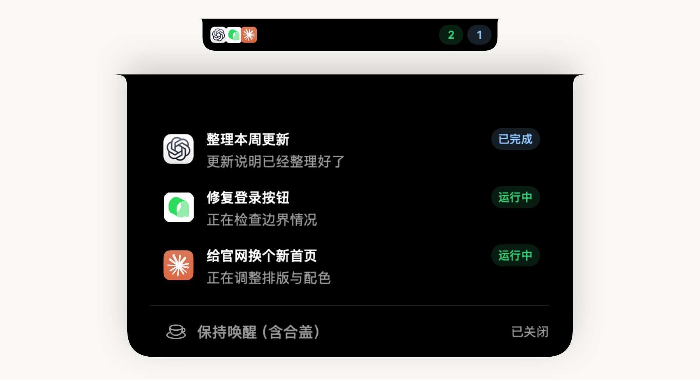
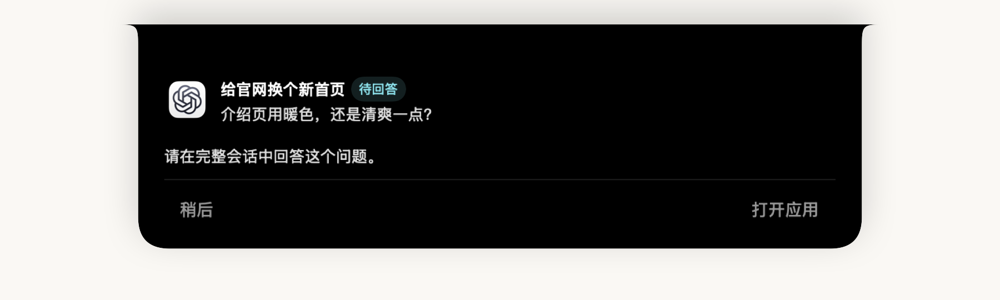
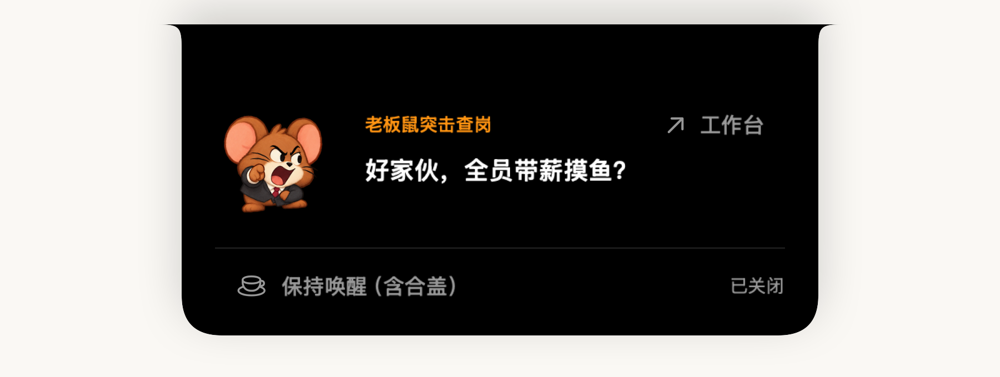
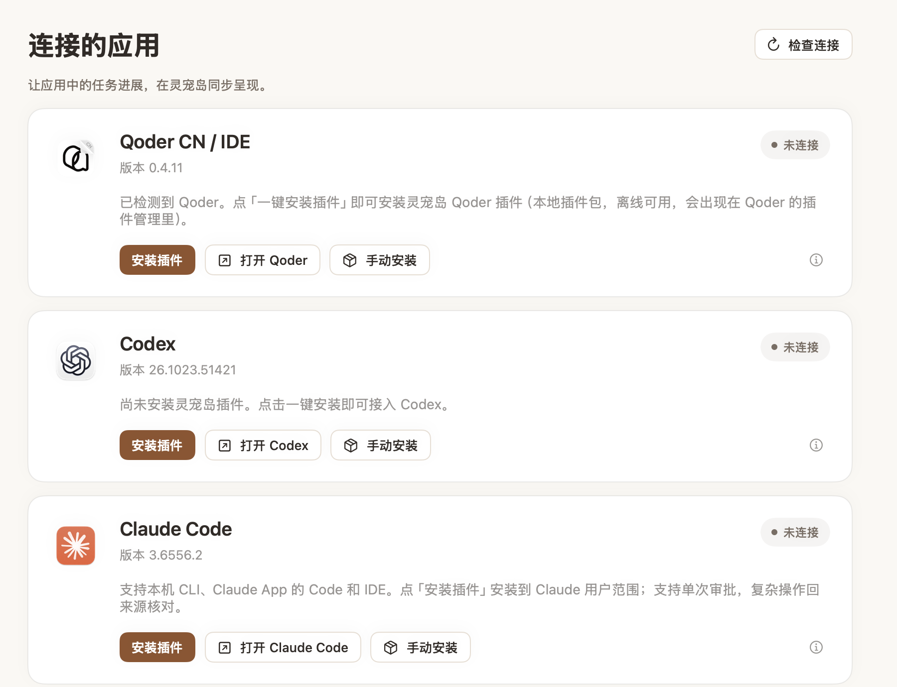
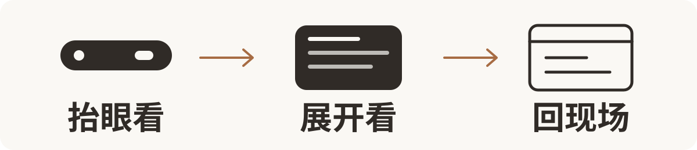

# 灵宠岛

**AI 分头忙，你一眼掌握。**

住在 Mac 屏幕顶部的小助手。AI 各忙各的，老板鼠替你盯着。

[看 30 秒介绍](#30-秒介绍) · [三步上岛](#三步上岛) · [为什么这样设计](#为什么是一座小岛)

macOS 14 及以上 · 搭载 M 系列芯片的 Mac

**活它盯，主意你拿。** 谁还在忙、谁已收工，抬眼就知道；点一下，回到原来的工具。

## 该你出马时，它才冒泡

需要回答、确认，或任务结束、遇到问题时，它会展开提醒。重要决定，还是你来。

## 闲下来？老板鼠还有话说

## 30 秒介绍

https://github.com/user-attachments/assets/04e7e4d5-7650-44f9-9cf1-bf679a2e9e2e

## 三步上岛

1. **下个岛。** 从 [Releases（版本发布）](https://github.com/LJjayyy/LingChongDao/releases)下载 `.dmg`。
2. **拖进去，打开它。** 拖到「Applications／应用程序」，再启动「灵宠岛」。
3. **叫上 AI 同事。** 在「连接的应用」安装连接插件，重启对应工具，再开一条新对话。

可以一起上班的有：**Codex、Qoder CN / IDE、Claude Code、ZCode、DeepSeek Harness、CodeBuddy CN、WorkBuddy**。老板鼠和图标随安装包一起入住。

## 为什么是一座“小岛”

**“灵”是 AI 的机灵，“宠”是老板鼠的陪伴。** “岛”借鉴了 iOS 灵动岛的设计，给 AI 同事们在 Mac 顶部安个小窝。[更多设计想法](docs/设计理念.md)。

上岛前的两个小问题

**第一次打不开？** 当前版本未经过 Apple 公证。确认下载来源后，按 [Apple 官方说明](https://support.apple.com/zh-cn/102445)处理系统提示。

**所有事情都能在岛上处理吗？** 问题通常回原工具回答；部分简单确认可以在岛上处理，以实际按钮为准。

[使用说明](docs/使用说明.md) · [隐私说明](PRIVACY.md) · [卸载与数据清理](docs/卸载与数据清理.md)

想一起造岛？

[贡献指南](CONTRIBUTING.md) · [DMG 构建与发布](docs/发布DMG.md) · [安全问题私下反馈](SECURITY.md)

---

由 [LJjayyy](https://github.com/LJjayyy) 制作。代码采用 [MIT 许可证](LICENSE)；角色、视频与其他素材的范围见 [素材说明](THIRD_PARTY_NOTICES.md)。
