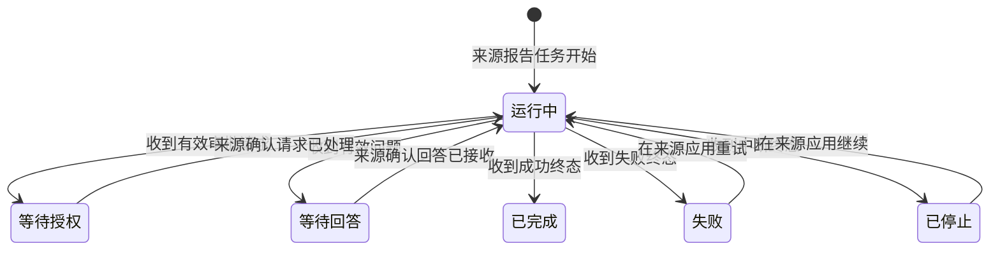
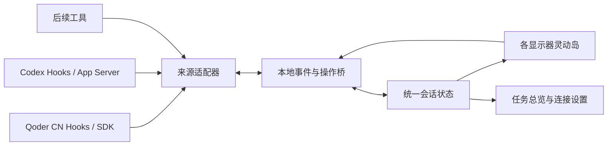

# 灵宠岛：Qoder CN 调研与首期产品方案

调研日期：2026 年 10 月 23 日。产品基线：macOS 上的 Qoder CN 0.4.9。

## 1. 结论

建议做成一个独立运行的 **macOS AI 任务伴随应用**：沿用 Qoder CN 灵动岛的形态、展开收起方式、任务卡片和设置逻辑，通过适配器接入 Qoder CN、Codex 等工具。

首期先保持 Qoder 的交互，不扩展成新的聊天客户端。通用化主要发生在事件接入、会话标识和操作回传层，用户仍围绕三件事使用它：**看进展、处理需要我决定的事、回到原任务**。

需要单独验证的是“接入用户已在运行的桌面会话”。公开接口能支撑某类能力，不代表任意已安装版本、任意现有会话都已开放。界面可以统一；操作能力必须按连接实际支持的范围呈现。

## 2. 本次证据范围

本报告区分三类信息：

| 标记 | 含义 | 使用方式 |
| --- | --- | --- |
| 已确认·公开文档 | Qoder、OpenAI、Apple 官方文档和项目官方仓库 | 说明公开能力与支持范围 |
| 已确认·静态实现 | 本机 Qoder CN 0.4.9 安装包中的界面逻辑、样式和常量 | 作为当前版本交互基线；仍需真实设备验收 |
| 建议 / 待验证 | 通用产品方案、接入推论、尚未执行的验证 | 不当作现有产品事实 |

本次未修改 Qoder 或 Codex 设置，未安装 Hook，未启动测试 Agent，未读取个人会话记录。对交互细节的核实来自截图与安装包静态检查，未进行运行中的多屏、审批和动画实测。

## 3. Qoder CN 现在提供什么

### 3.1 对应的产品与版本

这张截图对应的是全新 **Qoder CN 桌面工作台**的“设置 → 桌面宠物 → 屏幕顶部”，不是 Qoder CN IDE 的普通通知功能。官方在 **2026 年 10 月 22 日 / Qoder 0.4.9** 更新中明确列出灵动岛优化；本机安装包版本也是 0.4.9。[官方更新日志](https://docs.qoder.cn/product-overview/qoder-update-log)

官方确认它能在屏幕顶部查看任务进展、处理支持的问题及权限请求；复杂交互和完整对话返回对应任务。灵动岛与悬浮宠物可以分别开启，共用当前形象，并要求 Qoder 保持运行。该功能目前仅支持 macOS。[桌面宠物与灵动岛说明](https://docs.qoder.cn/qoder/desktop-pet#use-dynamic-island-on-macos)

### 3.2 截图直接确认的设置

| 设置 | 现有含义 | 通用应用首期要求 |
| --- | --- | --- |
| 显示灵动岛 | 总开关；不依赖悬浮宠物开关 | 独立开关，关闭不影响原工具执行 |
| 空闲时显示 | 无活动时仍显示宠物与问候；点击打开工作台 | 保留开关；独立应用的空闲入口打开任务总览 |
| 在其他显示器上显示 | 各屏幕顶部同步展示 | 保留同步选择；所有屏幕共用同一份会话状态 |
| 触觉反馈 | 通过 Force Touch 触控板反馈 | 有兼容硬件时生效 |
| 灵动岛大小 | 仅调整收起态的宽高，不影响展开内容 | 收起尺寸与展开布局分别管理 |
| 恢复默认大小 | 重置尺寸 | 同时重置宽、高 |
| 内置 / 外接预览 | 顶边衔接形态 / 完整胶囊形态 | 保留两种壳形；根据屏幕几何选择 |

截图中的开关状态和 100% 是拍摄时的当前值，不能据此推断所有设置的出厂默认值。静态代码进一步确认：主开关默认关闭、其他显示器默认关闭、空闲显示和触觉默认开启，宽高默认均为 100%。刘海屏收起高度不能小于刘海，界面已经明确提示。

### 3.3 静态实现确认的基础交互

| 用户动作 | Qoder CN 0.4.9 行为 |
| --- | --- |
| 鼠标进入有活动的收起态 | 立即出现轻微形变，停留约 300ms 后展开；空闲状态不会悬停展开内容 |
| 鼠标离开 | 约 100ms 后检查命中区域，收起由悬停打开的内容；输入焦点、固定状态和提交中会阻止意外收起 |
| 点击活动中的收起栏 | 切换展开状态 |
| 点击空闲栏 | 打开主工作台 |
| 按 Esc | 关闭展开内容 |
| 调整收起宽度 | 20%–130%，步长 5% |
| 调整收起高度 | 75%–125%，步长 5%，另受刘海最小高度约束 |

以上时间和范围来自本机版本的静态逻辑，不是根据截图估算。首期应固定这些行为作为复刻基线，再在真实屏幕上验证。

### 3.4 状态、内容与轻交互边界

| 状态 | 收起提示 | 展开内容和主要动作 |
| --- | --- | --- |
| 空闲 | 宠物与问候 | 点击打开工作台 |
| 执行中 | 最多三只会话宠物、运行状态和加载动画 | 最多三条任务，显示标题与当前活动；点任务回原会话 |
| 等待回答 | 问题提示 | 单选或自由文本；多题逐步前进；支持稍后、回原应用回答 |
| 等待权限 | 批准提示 | 描述和受限命令信息；满足条件才可批准；有效请求仍可拒绝，复杂批准回原应用 |
| 完成 | 新结果提示 | 本轮完成摘要、未读数、打开会话 |
| 失败或中断 | 异常提示 | 区分执行失败与已中断，可查看详情或关闭提示 |
| 请求过期 | 当前固定请求的失效状态 | 保留草稿并禁用提交，可回原会话核对 |
| 操作提交中或失败 | 对应卡片 | 锁住重复提交；失败可重试或回原会话 |

**排序不是按运行时间，也不是审批永远排第一。** 当前版本顺序是：等待回答 → 其他等待（含权限）→ 失败 / 中断 → 完成 → 执行中；同级按最近更新时间倒序。只向岛窗口提供前三项，但运行与等待计数来自全量任务。侧边对话、隐藏和归档任务不直接进入这份列表。终态会话还受未读状态筛选；没有确认到“完成后过几秒自动消失”的计时逻辑。

问题在 **最多 20 题且均非多选** 时可在岛内逐题回答，最后一起提交。自由文本上限 20,000 字符；输入法组词期间的 Enter 不直接提交。存在自动跳过时间的请求会显示倒计时，这不代表所有问题都有同样的默认超时。

Qoder 岛内允许批准的请求受到严格限制：工具必须是 Bash，参数字段在白名单内，无额外 reason 或 specArtifact；命令不超过 600 字符，工作目录不超过 400 字符，描述不超过 600 字符，还过滤包含凭据相关关键词的内容。复杂请求的批准返回完整会话，但有效请求仍可在岛内拒绝；过期和提交中禁用操作。后端提交前再次核对有效性与可批准条件。

通用产品应保留“可完整预览的轻量命令审批”这个语义边界。`Bash` 是 Qoder 的原生工具名，适配器要把各来源映射为统一的命令审批类型，通用层不能硬匹配这个名称。长度和预览范围也要按标准化内容明确规定；关键词过滤不能替代来源工具的权限校验。

### 3.5 尺寸和动效基线

以下为 0.4.9 的逻辑布局单位，不等于截图物理像素；实际尺寸还受屏幕和内容限制。

| 项目 | 有刘海衔接形态 | 无刘海胶囊形态 |
| --- | --- | --- |
| 默认空闲收起 | 宽 268；高不小于 32 或刘海高度 | 212 × 32 |
| 活动收起宽度（100%） | 随状态内容在约 360–412 范围内调整 | 随状态内容在约 212–280 范围内调整 |
| 纯运行任务列表展开宽度 | 420 | 420 |
| 问答、审批、结果展开宽度 | 590 | 552 |
| 展开高度 | 内容自适应，上限 480 | 内容自适应，上限 480 |
| 顶部位置 | 贴屏幕顶边 | 距顶边约 6 |

展开约 420ms、收起约 450ms、悬停形变约 417ms、内容过渡约 340ms，包含淡入、轻微缩放与模糊变化，并支持减少动态效果。收起后的原生窗口还会短暂保留动画空间；不能只做一个瞬间变高的普通提示框。

### 3.6 多屏不是多个独立编辑器

默认只选内置屏；没有内置屏时取显示器列表首项。开启其他显示器后，各屏接收相同任务状态，展开状态各自管理。**一次只允许一块屏幕固定请求并进行输入**，另一屏尝试输入会提示先完成现有输入；请求若在原窗口或另一屏被处理，保留中的草稿变成过期状态。

这些规则应纳入复刻，尤其不能将“同步显示”理解成两块屏幕可以同时编辑和提交同一份请求。

## 4. 通用化时，用户体验怎样保持一致

### 4.1 保留的核心结构

保留黑色顶部岛、宠物位置、收起与展开形态、任务摘要、任务卡片、任务优先级，以及现有屏幕设置的顺序和语义。岛内问答和批准先保留上面的轻交互语义边界，再与来源工具的实际能力取交集。第一版使用自有或已获授权的形象占位；Q 达鸭、Qoder 图标及原安装包素材不直接作为独立产品资产。

通用化只增加三个必要概念：

1. **任务来源**：展开卡片显示 Qoder CN / Codex 等来源及项目，避免同名任务混淆。
2. **连接管理**：管理已接入的应用、版本与可用能力，放在独立工作台的设置里。
3. **返回原任务**：任务卡的跳转由来源适配器执行；支持精确跳转时定位对应会话，否则如实回到来源应用。

空闲点击原本打开 Qoder 工作台，独立应用中改为打开自己的任务总览。总览只提供任务定位与连接设置，完整对话、代码审阅和重型操作继续由来源应用承载。

### 4.2 通用状态模型

把“任务状态”“是否展开”和“提示可见性”分开管理。同一任务可以在收起和展开时都处于等待审批，移开鼠标只改变视图，不改变任务状态。下图是任务状态；“空闲”是全岛没有活动或待展示任务时的聚合视图，已完成任务仍在总览中保留完成状态。

终态提示是否继续出现在岛上，跟随来源的未读 / 清理状态；清理提示不会改写任务终态。连接状态另设为“已连接 / 重连中 / 不可用”。失联不能显示成“任务完成”；单次工具报错也不直接等于整个任务失败。没有可靠总步骤数时只显示活动摘要，不生成虚假的百分比。

### 4.3 操作按能力呈现

| 岛上的内容 | 有双向接入能力 | 只有状态或通知能力 |
| --- | --- | --- |
| 运行进展 | 展示当前活动与可用摘要 | 展示已收到的状态及更新时间 |
| 权限请求 | 在首期轻交互范围内，按来源提供的选项允许 / 拒绝 | “前往处理” |
| 用户问题 | 在首期问题类型范围内，显示选项、输入框并回传 | “前往回答” |
| 停止任务 | 调用来源的中断接口并等待确认 | 跳回原应用处理 |
| 完整上下文 | 打开对应原任务 | 打开来源应用，标明定位限制 |

只有来源明确提供“本会话允许”等作用域时才展示相应按钮。点击提交后先显示处理中，收到回执再切换状态；超时、过期和原应用已经处理的请求要及时撤掉操作按钮。

这些降级属于跨工具接入限制，不能用外观相同的无效按钮掩盖。Qoder 原有的轻量问答和复杂交互返回任务的边界也应保留。

## 5. 接入可行性

### 5.1 Qoder CN：桌面已有公开 Hooks 路线

官方明确说明，Qoder CN 桌面任务使用与 CLI 兼容的 Hooks；支持 command、HTTP 等处理程序，可观察提交、工具执行、权限、通知、子任务等事件。配置出现在设置中不等于 Runtime 已加载，必须以真实任务触发验证。[Qoder CN Hooks](https://docs.qoder.cn/qoder/hooks)、[CLI Hooks 参考](https://docs.qoder.cn/cli/hooks-reference)

建议第一条接入路线为：**现有 Qoder 任务 → Hook → 本地桥接 → 灵动岛**。先做运行活动、任务结束候选事件和权限请求展示；同步审批桥在明确超时和回退语义后再启用。不要把 `Stop` 或 `SessionEnd` 简单映射为“任务成功”。

公开 SDK 文档已经给出 `PermissionRequest` 的允许 / 拒绝输出，也支持 `canUseTool` 回调把权限交给宿主 UI；这是双向审批的技术依据。不过 SDK 自己创建的会话与用户现存桌面会话是两条接入路径，仍需逐项验证桌面 Hook 的加载及回包效果。[SDK Hooks](https://docs.qoder.cn/cli/sdk/hooks#自动批准权限permissionrequest)、[SDK 权限控制](https://docs.qoder.cn/cli/sdk/permissions)

普通用户问题与 MCP elicitation 也要分开：文档列出 `AskUserQuestion` 工具和 Elicitation 事件，不足以证明桌面中所有问题都能被外部 Hook 接管。首期应先验证实际请求结构和回答通道，未验证时返回原任务。[SDK 类型参考](https://docs.qoder.cn/cli/sdk/references-typescript#askuserquestioninput-askuserquestionoutput)

### 5.2 Codex：公开能力足够，接入现有会话是技术关口

| 路线 | 可以承诺的范围 | 首期判断 |
| --- | --- | --- |
| App Server 深度接入 | 自己驱动的会话可接事件、审批、问题回复及中断 | 完整交互的主要候选路线，需固定版本 |
| 加入共享后台 Server 的 CLI | 新版文档公开共享服务与 remote 连接 | 优先验证同服务双客户端的请求归属和响应 |
| 现存桌面会话 + Hooks | 可观察部分本地生命周期，并研究审批桥 | 先按实际版本验证，不能预先承诺全量接管 |
| notify | 一轮结束提醒 | 只适合最小通知模式 |

Codex 官方协议提供任务开始、工具与消息事件、命令和文件审批、用户输入请求、停止和终态；可以覆盖灵动岛的核心操作。新版 CLI 也公开了共享后台服务和 remote 连接方式，但这些文档没有保证任意外部应用都能接管用户已经运行的桌面宿主。[App Server](https://learn.chatgpt.com/docs/app-server)、[Developer commands](https://learn.chatgpt.com/docs/developer-commands)

Codex Hooks 已覆盖权限请求，可研究本地同步审批桥；未查到用 Hook 接管所有问题回复或完整模型文本流的通用合同。`notify` 当前只适合一轮完成提醒，不能据此实现完整岛内交互。[Hooks](https://learn.chatgpt.com/docs/hooks)、[通知配置](https://learn.chatgpt.com/docs/config-file/config-advanced#notifications)

官方仍把 App Server 命令及 WebSocket 传输标为实验性，接口可能变化；应固定目标客户端版本和 schema，验证后纳入兼容矩阵。因此，“首期支持 Codex”需要具体写成：支持哪个客户端、哪个版本、哪种接法以及哪些岛内操作。尤其要避免另起一个 App Server、恢复历史 thread 后，把它描述成已接入原桌面实时任务。[Developer commands](https://learn.chatgpt.com/docs/developer-commands)

### 5.3 适配器能力表

每个连接单独声明以下能力，界面根据结果启用操作：

`状态 / 活动摘要 / 授权回传 / 问题回传 / 追问 / 中断 / 精确跳转 / 状态重同步`

能力应同时考虑来源版本与当前会话。有同样标题的任务时，以 `provider + host + sessionId + threadId` 区分；一轮和待处理请求另带 turnId、requestId。Codex 分支线程可能共享 sessionId，不能省略 threadId。来源能提供原生稳定标识时优先使用，不能用标题作为操作目标。[App Server 标识语义](https://learn.chatgpt.com/docs/app-server)

新增工具只需实现适配器，并不要求所有工具提供相同深度的接口。未来可再验证其他 CLI、IDE 与远程 Agent，当前不把尚未调研的来源列为已支持。

## 6. 推荐实现边界

建议首期由三部分组成：

| 部分 | 职责 |
| --- | --- |
| macOS 展示层 | 顶部窗口、刘海和胶囊形态、动画、焦点、触觉、多屏 |
| 本地桥接与会话状态 | 接入事件、排序、聚合、重连、请求有效性、响应回执 |
| 工具适配器 | 各工具的协议映射、能力探测、操作回传、跳回来源 |

不要让每个适配器各自实现一套岛的界面；也不要让视图直接解析各家的原始日志。多屏共用状态和待处理请求，一屏处理后其他屏立即同步，避免重复授权。

对于专注 macOS 的独立新应用，建议 **AppKit 的 NSPanel 管理窗口，SwiftUI 管理卡片与动画**。平时悬停浏览不激活主应用，主动回答时取得输入焦点，收起后妥善归还焦点；这些是不同的窗口行为，需要分别实现。[NSPanel 焦点语义](https://developer.apple.com/documentation/appkit/nspanel/becomeskeyonlyifneeded)、[NSHostingView](https://developer.apple.com/documentation/swiftui/nshostingview)

刘海位置建议读取每块屏幕的安全区域，并在插拔、重排、缩放变化后重算。Qoder 0.4.9 当前用内置屏和菜单栏间距启发式判断刘海；独立应用可以保持相同外观，同时使用系统屏幕几何提高适配准确性。[NSScreen safeAreaInsets](https://developer.apple.com/documentation/appkit/nsscreen/safeareainsets)、[screens](https://developer.apple.com/documentation/appkit/nsscreen/screens)

跨 Spaces、全屏、Stage Manager 应作为实机验证项，不承诺覆盖锁屏或所有系统界面。触觉用于用户主动展开、点击与回答操作，依赖 Force Touch 设备和系统设置，不能作为后台任务完成的保证提醒。[全屏辅助窗口行为](https://developer.apple.com/documentation/appkit/nswindow/collectionbehavior-swift.struct/fullscreenauxiliary)、[触觉反馈](https://developer.apple.com/documentation/appkit/nshapticfeedbackperformer/perform(_:performancetime:))

本地桥只接收已登记来源，审批响应绑定会话、轮次、请求与本次连接。应用退出或桥失联时，按来源协议回退到原工具处理或让请求明确失效，不自动放行。安装连接时合并已有 Hook，按来源要求完成配置审阅与信任，并提供只移除自身配置的断开方式。

## 7. 已存在的参考项目

已经存在同方向的 [AgentBro](https://github.com/shirenchuang/agentbro)：独立桌面灵动岛，加多种 AI Agent 接入。本次检查了公开源码而非只看 README，确认存在适配器注册、统一事件、本地 Hook bridge、Codex 审批和用户问题响应实现。检查基线固定为 [`06fe149f`](https://github.com/shirenchuang/agentbro/commit/06fe149fdfa23f8ef958279dfa1395b46c7a1243)，包版本 3.1.0；没有运行软件。

可借鉴的部分是[适配器接口](https://github.com/shirenchuang/agentbro/blob/06fe149fdfa23f8ef958279dfa1395b46c7a1243/src-tauri/src/agents/traits.rs)、[统一事件结构](https://github.com/shirenchuang/agentbro/blob/06fe149fdfa23f8ef958279dfa1395b46c7a1243/src-tauri/src/agents/mod.rs)和[操作能力门控](https://github.com/shirenchuang/agentbro/blob/06fe149fdfa23f8ef958279dfa1395b46c7a1243/src/utils/sessionCapabilities.ts)。它也管理 Skills、MCP、插件与供应商等，功能面比本项目首期更宽。

需要留意，它部分 Codex 路线会自己启动 App Server，另有读取 rollout 后注入回答、通过系统自动化回复等回退。这些代码的存在不能证明它能接管另一个既有 Codex Desktop 进程的所有交互，仍要验证目标版本和会话归属。[Codex 接入实现](https://github.com/shirenchuang/agentbro/blob/06fe149fdfa23f8ef958279dfa1395b46c7a1243/src-tauri/src/agents/codex_app_server.rs)、[命令与回传实现](https://github.com/shirenchuang/agentbro/blob/06fe149fdfa23f8ef958279dfa1395b46c7a1243/src-tauri/src/commands/mod.rs)

项目代码为 Apache-2.0，可进入具体模块的复用评估；NOTICE 与商标说明把品牌资产单独排除，并要求修改分发版更名。[LICENSE](https://github.com/shirenchuang/agentbro/blob/06fe149fdfa23f8ef958279dfa1395b46c7a1243/LICENSE)、[NOTICE](https://github.com/shirenchuang/agentbro/blob/06fe149fdfa23f8ef958279dfa1395b46c7a1243/NOTICE)、[TRADEMARKS](https://github.com/shirenchuang/agentbro/blob/06fe149fdfa23f8ef958279dfa1395b46c7a1243/TRADEMARKS.md)

建议**以 Qoder 为前台规格基线，原生新建专注的 macOS 应用，优先借鉴 AgentBro 的接入架构**，接入验证时再评估局部代码复用。若改为整仓改造，其现有技术栈是 Tauri / React / Rust，需要重新选择实现路线；整仓改造是否更省成本，本次未作工程验证。

## 8. 开发顺序与验收

### 阶段 A：固定行为规格，并行验证真实接入

把本报告的 0.4.9 交互确定为基线，同时优先做两个技术验证：

1. **Qoder CN 现有桌面任务**：Hook 能否实时推送进度，权限回包是否生效，原应用与岛是否同步；普通问题能否获得稳定回答通道。
2. **Codex 现有工作流**：目标版本是否可加入同一 Server；另一客户端是否接到待处理请求，是否可以回答，以及重连后如何恢复请求。桌面没有公开通道时验证 Hook 降级。

这两个验证决定首发接入矩阵，应该在投入完整产品实现前完成。仅验证灵动岛自己新建的任务，不能替代这一步。

### 阶段 B：复现 Qoder 前台并接入测试事件

接入验证通过后，使用测试事件复现空闲、执行、待回答、待授权、多任务、完成和异常场景。在有刘海、无刘海及外接屏验证收起 / 展开、焦点和尺寸设置，再接真实事件。视觉与交互以 0.4.9 为基线，后续原版升级不自动改变本产品行为。

### 阶段 C：形成可交付的独立应用

实现菜单栏入口、任务总览、连接管理、按能力显示操作、请求回执和多屏状态同步。首期让 Qoder CN 与 Codex 真实任务同时出现在同一个岛中，完成至少一次来源内发起、岛内处理、来源内确认的闭环。

建议验收用例：

| 场景 | 通过条件 |
| --- | --- |
| 空闲开关 | 开启显示问候；关闭无活动时隐藏；点击按预定入口打开总览 |
| 悬停与收起 | 300ms / 100ms 基线，输入中不会因移开鼠标丢失内容 |
| 三个不同来源任务 | 来源、项目、会话定位清楚；排序稳定；无串任务操作 |
| 一次授权 | 来源提供什么作用域，岛就提交什么；收到回执后才更新 |
| 原应用先处理 | 岛上请求立即失效，不能再次提交 |
| 两屏同时操作 | 一个请求只产生一个有效决策，其余屏同步清除 |
| 问答超出岛能力 | 可顺畅返回原任务，原问题内容不丢失 |
| 断线、睡眠与重连 | 不误报完成；恢复后先同步状态，再恢复有效操作 |
| 失败与停止 | 与成功完成区分，工具局部错误不误报为整个任务失败 |
| 来源应用退出 | 清除或标记失效请求，不保留可点击的旧授权 |

首期不需要加入全量聊天编辑器、文件差异审阅、宠物市场、模型管理或跨设备同步。先把当前 Qoder 灵动岛的日常使用体验，以及两个来源的真实接入闭环做完整。

## 9. 仍需确认的事项

- 本机 0.4.9 的静态行为在运行时是否受系统设置、主窗口焦点、全屏 App 与不同显示器排列影响。
- Qoder 桌面 Hook 各事件的实际载荷、加载时机、审批回包和超时回退；普通问题的通用回答通道。
- Codex 目标桌面 / CLI 版本的共享服务接入条件，双客户端请求处理与重连补发。
- 各来源是否提供公开的精确会话跳转方式；没有时采用应用级跳转并说明限制。
- 宠物形象与产品名称的最终选择。它们不应阻塞前面的测试事件与接入验证。

## 附录：本机静态证据定位

核实对象为 `/Applications/Qoder CN.app`，Bundle ID 为 `com.qodercn.app`，版本 0.4.9。归档为 `Contents/Resources/app.asar`，相关归档内路径如下；文件名随版本可能变化。

| 位置 | 本次核实内容 |
| --- | --- |
| `/out/renderer/assets/CcQNe4dP.js`，DynamicIslandPanel | 展开、悬停、点击、焦点、问答、授权卡与尺寸 |
| `/out/renderer/assets/D3W25yZV.js`，DynamicIslandSurface | 深色表面、状态 revision、布局测量 |
| `/out/renderer/assets/DynamicIslandPanel-CNc2U10O.css` | 壳形、颜色、布局 |
| `/out/renderer/assets/Divk50kS.js`，设置页相关模块 | 开关、滑杆范围、默认值和重置 |
| `/out/renderer/assets/CqKR0SCX.js`，dynamicIsland 文案 | 状态文案、过期与错误提示 |
| `/out/main/electronMain.js`，VOe / Nm0 / nF0 / JOe / Hm0 | 会话投影、授权边界、排序、多屏窗口、动作前校验 |

Qoder 的原岛订阅自己的内部会话活动源，动作也回写内部聊天控制接口；这解释了它为什么目前只服务自身。内部 preload / IPC 不是已开放的第三方 API。独立产品应使用上文核实的公开接入路线，按行为规格自行实现展示层。

## 后续 UI/UX 设计交付

用户已确定：UI/UX按Qoder CN复刻，在同一视觉与交互语法下扩展多来源。设计基线、可交互浏览器原型、设置对照、状态图与24项原型检查已完成；真实Agent与原生窗口验收仍独立进行。参见同目录[《UIUX设计基线》](UIUX设计基线.md)；早期浏览器原型与取证已归档。
